# CS03 rerun on claude-fable-5-1
Prompt: prompt_sent_CS03.txt (Set E text from manuscript v2.18 plus inputs). End: final artifact reached. Cost: $2.5344

---
## Turn 1 (2026-10-21T20:02:54-07:00)
### User
```
<mission>
Produce the documentation set below, get my approval, and only then plan code, so every
later coding turn reads one stable set of files instead of chat history.
</mission>

<agent>
Staff eng... [full prompt in prompt file]
```
### Usage
{"input_tokens": 4, "cache_creation_input_tokens": 3541, "cache_read_input_tokens": 0, "cache_creation": {"ephemeral_5m_input_tokens": 3541, "ephemeral_1h_input_tokens": 0}, "output_tokens": 3535, "service_tier": "standard", "inference_geo": "global", "speed": "standard", "output_tokens_details": {"thinking_tokens": 1226}}
Stop: end_turn. Cost: $0.22105
### Assistant

# Artifact 1: Assumptions and Open Questions

No code in this message. Phase 1 only.

## docs/ASSUMPTIONS.md

```markdown
# Assumptions and Open Questions

Status: draft, waiting for owner review.
Mission in one sentence: Build a local web tool that searches the Project Gutenberg catalog
CSV, filters by language and Type, saves a short reading list, and exports it as Markdown.

## 1. Known facts (from the brief and the dataset notes)

| ID | Fact | Source |
|----|------|--------|
| KF-01 | Input is pg_catalog.csv from https://www.gutenberg.org/cache/epub/feeds/pg_catalog.csv | Owner input |
| KF-02 | File downloaded 2026-10-21, 21,263,721 bytes, 79,634 rows, counted with Python csv | Owner input |
| KF-03 | Columns: Text#, Type, Issued, Title, Language, Authors, Subjects, LoCC, Bookshelves | Owner input, CSV header |
| KF-04 | Users are readers and teachers | docs/brief.md |
| KF-05 | Search fields: title, author, subject. Filters: language, Type | docs/brief.md |
| KF-06 | Each result links to the book page on gutenberg.org | docs/brief.md |
| KF-07 | User saves a short reading list and exports it as Markdown | docs/brief.md |
| KF-08 | Nothing is uploaded anywhere. Catalog refresh is manual | docs/brief.md |
| KF-09 | Stack: Python 3.12, FastAPI, SQLite | Owner input |
| KF-10 | Agents: Claude Code and Cursor. Rules files under 150 lines | Owner input |
| KF-11 | Coverage target 80 percent | Owner input |
| KF-12 | Style: no em dashes or en dashes; no tool credit lines in files or commits | Owner input |
| KF-13 | Secrets only in .env; .env in .gitignore; .env.example has names only | Owner input |

Note: docs/brief.md does not exist yet. Phase 2 will create it with the brief text verbatim.
Until then, traceability rows that cite it are marked "UNVERIFIED (file not found)".

## 2. Unknowns (each has a variable; please fill or accept the default)

| ID | Unknown | Variable | Proposed default |
|----|---------|----------|------------------|
| UK-01 | Search matching rule | [SEARCH_MODE] | Case-insensitive substring match, SQL LIKE. Filters combine with AND |
| UK-02 | Whether SQLite FTS5 is used | [USE_FTS] | No. LIKE is simpler and fast enough for 80k rows; FTS5 is a listed option |
| UK-03 | Result page size | [PAGE_SIZE] | 50 rows per page |
| UK-04 | Maximum reading list size | [LIST_MAX] | 100 items |
| UK-05 | One list or many named lists | [LIST_MODEL] | One list per local install, no login |
| UK-06 | Where the reading list is stored | [LIST_STORE] | A SQLite table, same database file as the catalog |
| UK-07 | Catalog refresh method | [REFRESH_METHOD] | A CLI command: import a CSV path, replace all catalog rows, keep the reading list |
| UK-08 | Book page URL pattern | [BOOK_URL] | https://www.gutenberg.org/ebooks/{Text#}. UNVERIFIED, not read today |
| UK-09 | Authors field format (separator, dates) | [AUTHORS_FORMAT] | Shown as raw text. No parsing. UNVERIFIED |
| UK-10 | Subjects field format (separator) | [SUBJECTS_FORMAT] | Shown as raw text. Substring search only. UNVERIFIED |
| UK-11 | Frontend approach | [FRONTEND] | Server-rendered Jinja2 templates, plain HTML forms, no JS build step |
| UK-12 | Bind address and port | [HOST] [PORT] | 127.0.0.1, 8000 |
| UK-13 | Dependency tool | [DEP_TOOL] | pip with a pinned requirements.txt |
| UK-14 | Search latency target | [LATENCY_MS] | Under 500 ms per search on a laptop, warm cache |
| UK-15 | Accessibility target | [A11Y] | WCAG 2.1 AA for forms, labels, keyboard use. UNVERIFIED link, not read today |
| UK-16 | Markdown export shape | [EXPORT_FORMAT] | One bullet per book: title, authors, link |
| UK-17 | Dataset license terms for local reuse | [DATA_LICENSE] | UNVERIFIED. Treat as public catalog data; cite source URL in docs |
| UK-18 | Rows with empty Title or Text# | [BAD_ROWS] | Skip on import, count them, log the count |

## 3. Assumptions (hold unless you object)

| ID | Assumption |
|----|------------|
| AS-01 | The tool runs on one machine for one person at a time. No auth. |
| AS-02 | Text# is a unique integer and is the primary key for catalog rows. |
| AS-03 | Language and Type have few distinct values, so they can fill dropdowns. |
| AS-04 | The CSV is UTF-8 encoded. If not, import fails with a clear error. |
| AS-05 | The app never calls the network. Links open in the user's browser only. |
| AS-06 | No secrets are needed today. .env still exists for [HOST], [PORT], [DB_PATH]. |
| AS-07 | Tests use pytest and FastAPI's TestClient with a small sample CSV fixture. |
| AS-08 | Export is a file download from the browser, not a file write on the server. |

## 4. Clarifying questions (only these change the PRD)

1. Search: is substring LIKE match acceptable ([SEARCH_MODE]), or do you want ranked
   full-text search with FTS5? This changes FR text, the ERD, and the Big-O table.
2. Reading list: one list per install, or several named lists ([LIST_MODEL])? This
   changes the ERD and adds two to three FRs.
3. Refresh: is a CLI import command acceptable ([REFRESH_METHOD]), and must the reading
   list survive a refresh? This changes one FR and the state diagram.
```

Gate: FAIL, because UK-01 to UK-18, AS-01 to AS-08, and the three questions are open until you answer or accept them. Reply "accept defaults" or list changes, and I will start Phase 2.

---
## Turn 2 (2026-10-21T20:03:42-07:00)
### User
```
Accepted, continue to the next phase.
```
### Usage
{"input_tokens": 4, "cache_creation_input_tokens": 2324, "cache_read_input_tokens": 3541, "cache_creation": {"ephemeral_5m_input_tokens": 2324, "ephemeral_1h_input_tokens": 0}, "output_tokens": 5867, "service_tier": "standard", "inference_geo": "global", "speed": "standard", "output_tokens_details": {"thinking_tokens": 901}}
Stop: end_turn. Cost: $0.32598
### Assistant

# Artifact 2: PRD

No code in this message. Phase 2 only. The three private think lines are done and not shown.

## docs/brief.md

```markdown
# Project Brief (verbatim from the owner, 2026-10-21)

A small local web tool for readers and teachers. It loads the public Project Gutenberg
catalog CSV (columns Text#, Type, Issued, Title, Language, Authors, Subjects, LoCC,
Bookshelves; about 79,600 rows). The user searches by title, author or subject, filters by
language and Type, and gets a list with a link to each book's page on gutenberg.org. The
user can save a short reading list and export it as Markdown. Nothing is uploaded anywhere;
the catalog is refreshed by hand.

Dataset: https://www.gutenberg.org/cache/epub/feeds/pg_catalog.csv
Downloaded 2026-10-21. 21,263,721 bytes. 79,634 rows. Counted with Python csv.
Header row: Text#,Type,Issued,Title,Language,Authors,Subjects,LoCC,Bookshelves
```

## docs/PRD.md

```markdown
# PRD: Gutenberg Catalog Browser

Version 0.1. Status: waiting for owner review.
Source of truth for behavior. Plans, diagrams, tasks and code derive from this file.
Defaults come from docs/ASSUMPTIONS.md (all accepted on 2026-10-21).

## 1. Problem

Readers and teachers want to find public domain books by title, author or subject.
The Project Gutenberg catalog is a 21 MB CSV with about 79,600 rows.
A spreadsheet is slow and has no link list or export.
This tool gives fast local search, filters, a saved reading list, and a Markdown export.

## 2. Users

| User | Need |
|------|------|
| Reader | Find a book quickly and open its gutenberg.org page. |
| Teacher | Collect a short list for a class and share it as Markdown. |

One person uses the tool on one machine. There is no login.

## 3. Goals and non-goals

Goals:
- G1. Search 79,600 rows in under 500 ms on a laptop.
- G2. Keep all data local. No uploads, no outbound calls from the server.
- G3. Export a reading list as a Markdown file.

Non-goals:
- Downloading or reading book text.
- Multi-user accounts or sync.
- Automatic catalog refresh.

## 4. Functional requirements

Each FR has Given / When / Then acceptance criteria. Each criterion is a test case.

### FR-01 Import catalog
The system shall import a catalog CSV from a file path given on the command line.
The system shall replace all catalog rows and keep the reading list.
The system shall skip rows with an empty Text# or empty Title and report the skipped count.

- AC-01.1 Given a valid CSV with 10 rows, when `import` runs, then the catalog table has 10 rows.
- AC-01.2 Given a catalog already loaded, when `import` runs with a new file, then only rows from the new file remain.
- AC-01.3 Given a reading list with 2 items, when `import` runs, then both items remain.
- AC-01.4 Given 2 rows with an empty Title, when `import` runs, then they are skipped and the log says "skipped 2".
- AC-01.5 Given a file that is not UTF-8, when `import` runs, then it exits non-zero with a clear message.
- AC-01.6 Given a file missing a required column, when `import` runs, then it exits non-zero and names the column.

### FR-02 Text search
The system shall accept one query string and match it against Title, Authors and Subjects.
The match shall be case-insensitive substring match. A row matches if any field matches.

- AC-02.1 Given a row with Title "Pride and Prejudice", when the query is "prejudice", then the row is returned.
- AC-02.2 Given a row with Authors "Austen, Jane", when the query is "austen", then the row is returned.
- AC-02.3 Given a row with Subjects "Fiction", when the query is "fiction", then the row is returned.
- AC-02.4 Given a query with no match, when search runs, then the page shows "No results" and zero rows.
- AC-02.5 Given an empty query and no filters, when search runs, then the page shows no rows and a prompt to enter a query.
- AC-02.6 Given a query containing `%` or `_`, when search runs, then those characters are matched literally.

### FR-03 Filters
The system shall filter results by Language and by Type. Filters combine with AND.
Filters combine with the query with AND. An empty filter means "any".

- AC-03.1 Given rows in "en" and "fr", when Language is "fr", then only "fr" rows are returned.
- AC-03.2 Given rows of Type "Text" and "Sound", when Type is "Sound", then only "Sound" rows are returned.
- AC-03.3 Given Language "en" and Type "Text", when search runs, then every row has both values.
- AC-03.4 Given filters set and an empty query, when search runs, then filtered rows are returned.

### FR-04 Filter options
The system shall fill the Language and Type dropdowns from distinct values in the catalog.
Values shall be sorted alphabetically.

- AC-04.1 Given rows with Language "en", "fr", "en", when the search page loads, then the dropdown lists "en" and "fr" once each.
- AC-04.2 Given an empty catalog, when the search page loads, then both dropdowns show only "Any".

### FR-05 Pagination
The system shall return [PAGE_SIZE] = 50 rows per page, sorted by Title.
The system shall show the total match count and links to the previous and next page.

- AC-05.1 Given 120 matching rows, when page 1 loads, then 50 rows and "120 results" are shown.
- AC-05.2 Given 120 matching rows, when page 3 loads, then 20 rows are shown and there is no next link.
- AC-05.3 Given a page number beyond the last page, when it loads, then zero rows and no error are shown.
- AC-05.4 Given a page number of 0 or a non-integer, when it loads, then page 1 is used.

### FR-06 Book link
The system shall show, for each result, Text#, Title, Authors, Language, Type, Issued.
The system shall render a link built from [BOOK_URL_TEMPLATE] and Text#.
Default template: `https://www.gutenberg.org/ebooks/{id}`. UNVERIFIED, not read today.
The template is a setting, so the FR does not depend on the unverified URL.

- AC-06.1 Given Text# 1342 and the default template, when a result renders, then the href is `https://www.gutenberg.org/ebooks/1342`.
- AC-06.2 Given a changed template in settings, when a result renders, then the href uses the new template.
- AC-06.3 Given any result link, when it renders, then it has `rel="noopener"` and opens in a new tab.

### FR-07 Add to reading list
The system shall add a catalog row to the reading list by Text#.
The system shall reject duplicates and enforce [LIST_MAX] = 100 items.

- AC-07.1 Given an empty list, when the user adds Text# 1342, then the list has 1 item.
- AC-07.2 Given Text# 1342 in the list, when the user adds it again, then the list still has 1 item and a notice is shown.
- AC-07.3 Given 100 items, when the user adds one more, then it is rejected and "List is full" is shown.
- AC-07.4 Given a Text# not in the catalog, when the user adds it, then a 404 message is shown.

### FR-08 Remove from reading list
The system shall remove an item from the reading list by Text#.

- AC-08.1 Given Text# 1342 in the list, when the user removes it, then the list no longer has it.
- AC-08.2 Given Text# 1342 not in the list, when the user removes it, then the list is unchanged and no error is shown.

### FR-09 View reading list
The system shall show the reading list with Title, Authors and the book link.
Items shall be sorted by the time they were added, oldest first.

- AC-09.1 Given 3 items added in order A, B, C, when the list page loads, then they appear as A, B, C.
- AC-09.2 Given an empty list, when the list page loads, then "Your list is empty" is shown.

### FR-10 Export reading list as Markdown
The system shall export the reading list as a downloadable `.md` file.
Each item shall be one bullet: `- [Title](link) by Authors`.

- AC-10.1 Given 2 items, when the user clicks Export, then the response has `Content-Type: text/markdown` and 2 bullet lines.
- AC-10.2 Given Title "Pride and Prejudice", Authors "Austen, Jane", Text# 1342, when exported, then the line is `- [Pride and Prejudice](https://www.gutenberg.org/ebooks/1342) by Austen, Jane`.
- AC-10.3 Given an empty list, when the user clicks Export, then the file has a heading and the line "No books saved."
- AC-10.4 Given a Title containing `]`, when exported, then the character is escaped as `\]`.

### FR-11 Empty catalog guidance
The system shall show a clear message when the catalog table is empty or the database file is missing.

- AC-11.1 Given no database file, when the search page loads, then it shows "Catalog not loaded" and the import command.
- AC-11.2 Given an empty catalog table, when search runs, then the same message is shown and no error is raised.

## 5. Non-functional requirements

### Security
- NFR-S1. The server shall bind to [HOST] = 127.0.0.1 by default.
- NFR-S2. The server shall make no outbound network calls. Tests assert no socket connect.
- NFR-S3. All SQL shall use parameterized queries. No string formatting of user input into SQL.
- NFR-S4. Settings ([HOST], [PORT], [DB_PATH], [BOOK_URL_TEMPLATE]) live in `.env`. `.env` is in `.gitignore`. `.env.example` lists names only.
- NFR-S5. Templates shall escape all output by default (Jinja2 autoescape on).
- NFR-S6. Dependencies shall be pinned to exact versions in `requirements.txt`.

### Performance
- NFR-P1. A search over the full catalog shall return in under [LATENCY_MS] = 500 ms, measured on a laptop with a warm cache. UNVERIFIED until measured in Phase 5 task.
- NFR-P2. Import of the full 79,634 row catalog shall finish in under [IMPORT_TIME_S] = 120 s.
- NFR-P3. Import shall use one transaction and batched inserts.

### Accessibility
- NFR-A1. Every form control shall have a visible `<label>`.
- NFR-A2. All actions shall work with keyboard only.
- NFR-A3. Pages shall use semantic HTML: `<main>`, `<nav>`, `<table>` with `<th>`.
- NFR-A4. Target: WCAG 2.1 AA. UNVERIFIED, not read today.

### Reliability
- NFR-R1. Import is atomic. If it fails, the old catalog stays intact.

## 6. Traceability

| FR | Source | Note |
|----|--------|------|
| FR-01 | docs/brief.md ("the catalog is refreshed by hand"); pg_catalog.csv header | Skip rule from UK-18 |
| FR-02 | docs/brief.md ("searches by title, author or subject") | LIKE match from UK-01 |
| FR-03 | docs/brief.md ("filters by language and Type") | |
| FR-04 | Derived from FR-03 and AS-03 | Not in brief |
| FR-05 | Derived from UK-03 | Not in brief |
| FR-06 | docs/brief.md ("a link to each book's page on gutenberg.org") | URL pattern UNVERIFIED, made a setting |
| FR-07 | docs/brief.md ("save a short reading list") | Limit from UK-04 |
| FR-08 | Derived from FR-07 | Not in brief |
| FR-09 | docs/brief.md ("save a short reading list") | |
| FR-10 | docs/brief.md ("export it as Markdown") | Format from UK-16 |
| FR-11 | Derived from FR-01 and AS-04 | Not in brief |
| NFR-S1, S2 | docs/brief.md ("Nothing is uploaded anywhere") | |

Column list source: pg_catalog.csv header as supplied by the owner on 2026-10-21.

## 7. Risks

| ID | Risk | Mitigation |
|----|------|------------|
| R1 | CSV fields contain newlines or quotes and break naive parsing. | Use Python `csv` module, which handles quoted fields. Test with a fixture that has both. |
| R2 | LIKE search is slow without indexes. | SQLite LIKE cannot use a normal index for `%x%`. Measure in Phase 5. Fall back to FTS5 if over 500 ms. |
| R3 | Book URL pattern is wrong. | Template is a setting. Owner verifies one link by hand after first run. |
| R4 | Authors and Subjects formats are unknown. | Shown and matched as raw text. No parsing. |
| R5 | Memory use during import of a 21 MB file. | Stream rows; never load the whole file into memory. |
| R6 | Agent adds a JS build step or external CDN. | Rules files forbid it. Server-rendered HTML only. |

## 8. Out of scope

- Downloading or displaying book contents.
- Automatic catalog updates or scheduled jobs.
- Multiple reading lists, accounts, or sharing links.
- Ranked or fuzzy search.
- Parsing Authors into separate names or dates.
- Any deployment beyond localhost.
```

Gate check:
- Every FR (01 to 11) has at least one Given / When / Then criterion. Yes, 37 criteria total.
- No FR depends on an unverified API. FR-06 uses a configured template; the default URL is labeled UNVERIFIED and is data, not an API dependency.
- Traceability: every FR maps to docs/brief.md, the CSV header, or a derivation note. docs/brief.md is created in this artifact.

Gate: PASS

Reply "continue" for Phase 3 (diagrams and architecture), or list PRD changes first.

---
## Turn 3 (2026-10-21T20:04:51-07:00)
### User
```
Accepted, continue to the next phase.
```
### Usage
{"input_tokens": 4, "cache_creation_input_tokens": 4981, "cache_read_input_tokens": 5865, "cache_creation": {"ephemeral_5m_input_tokens": 4981, "ephemeral_1h_input_tokens": 0}, "output_tokens": 8003, "service_tier": "standard", "inference_geo": "global", "speed": "standard", "output_tokens_details": {"thinking_tokens": 566}}
Stop: end_turn. Cost: $0.46832
### Assistant

# Artifact 3: Design docs

No code in this message. Phase 3 only. All diagrams are Mermaid. Each file names the FR IDs it covers.

## docs/diagrams/01_user_story_map.md

```markdown
# User story map

Covers: FR-01, FR-02, FR-03, FR-04, FR-05, FR-06, FR-07, FR-08, FR-09, FR-10, FR-11

Activities left to right. Stories top to bottom under each activity.

```mermaid
flowchart LR
  subgraph A1["Load catalog"]
    S1["Import CSV by CLI (FR-01)"]
    S2["See guidance if catalog is empty (FR-11)"]
  end
  subgraph A2["Find books"]
    S3["Type a query (FR-02)"]
    S4["Pick language and Type (FR-03, FR-04)"]
    S5["Page through results (FR-05)"]
    S6["Open book page on gutenberg.org (FR-06)"]
  end
  subgraph A3["Keep a list"]
    S7["Add a book (FR-07)"]
    S8["Remove a book (FR-08)"]
    S9["View the list (FR-09)"]
  end
  subgraph A4["Share"]
    S10["Export list as Markdown (FR-10)"]
  end
  A1 --> A2 --> A3 --> A4
```
```

## docs/diagrams/02_use_cases.md

```markdown
# Use cases

Covers: FR-01 to FR-11

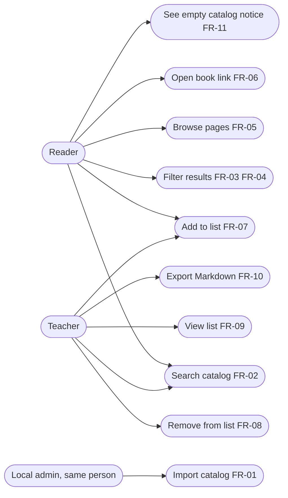
```

## docs/diagrams/03_architecture.md

```markdown
# Architecture

Covers: FR-01 to FR-11, NFR-S1, NFR-S2, NFR-S3

Everything runs on one machine. The only outbound link is opened by the browser, not the server.

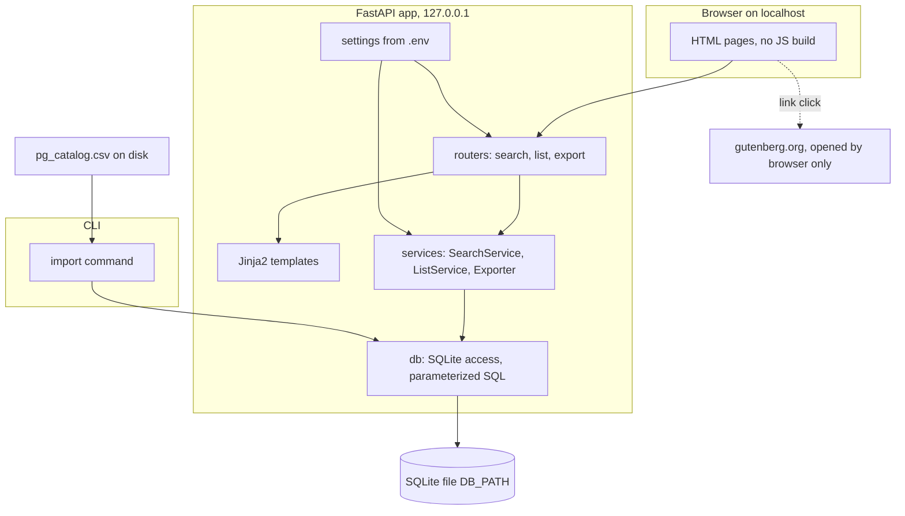
```

## docs/diagrams/04_sequence_search.md

```markdown
# Sequence: search with filters and paging

Covers: FR-02, FR-03, FR-04, FR-05, FR-06, FR-11

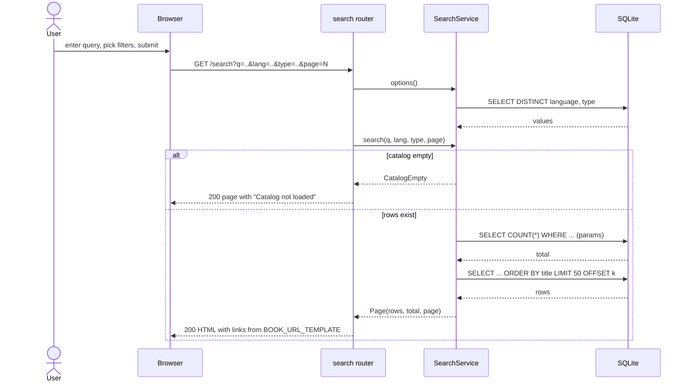
```

## docs/diagrams/05_sequence_reading_list.md

```markdown
# Sequence: add and remove reading list items

Covers: FR-07, FR-08, FR-09

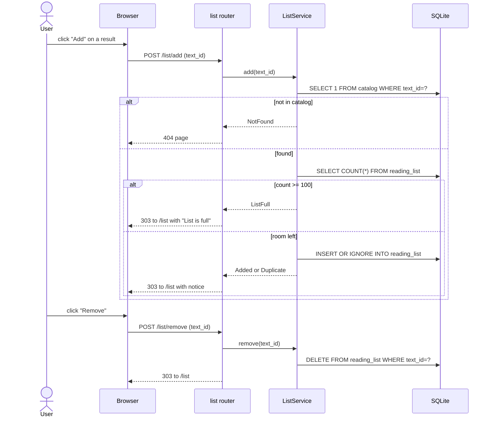
```

## docs/diagrams/06_sequence_export.md

```markdown
# Sequence: export reading list as Markdown

Covers: FR-09, FR-10

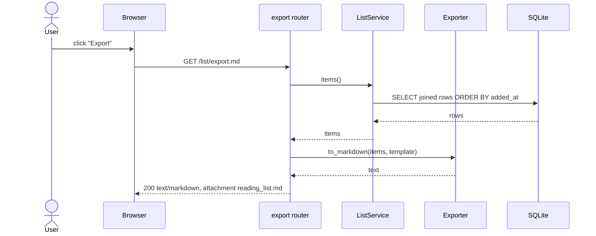
```

## docs/diagrams/07_sequence_import.md

```markdown
# Sequence: import catalog from CLI

Covers: FR-01, NFR-R1, NFR-P3

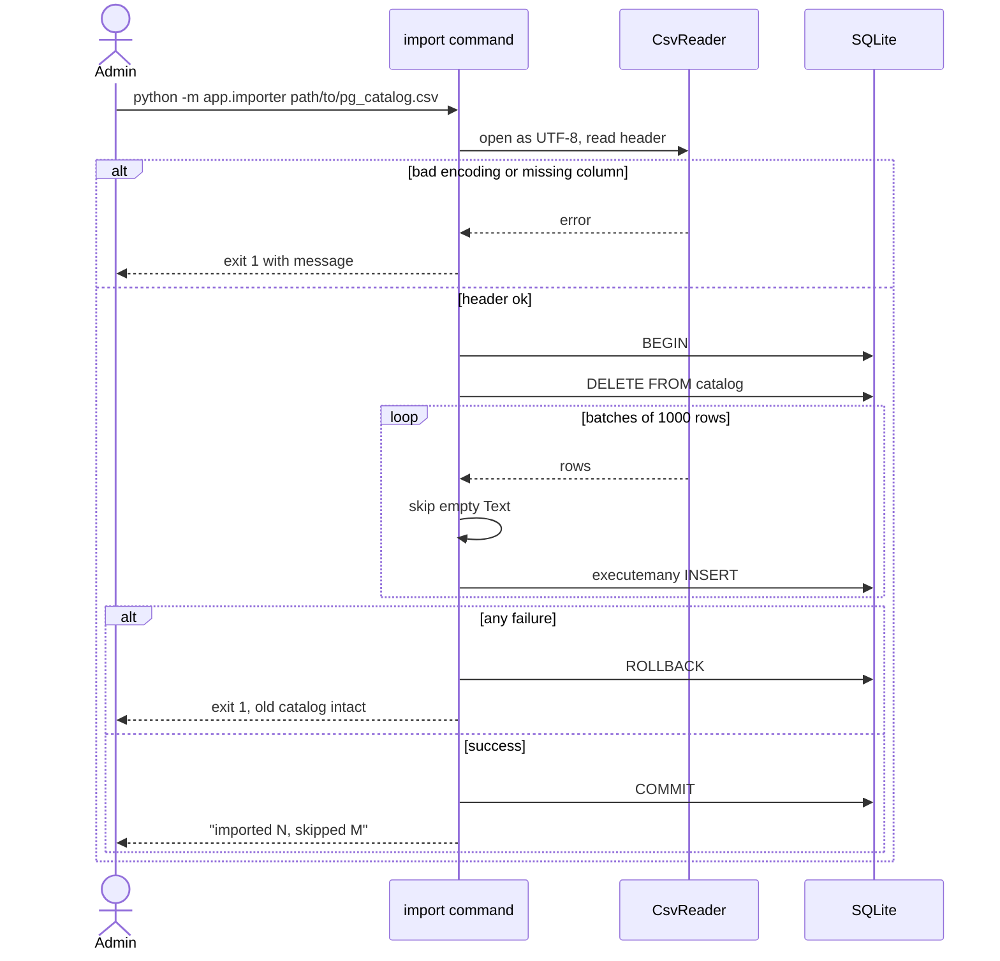
```

## docs/diagrams/08_data_flow.md

```markdown
# Data flow

Covers: FR-01, FR-02, FR-03, FR-05, FR-06, FR-07, FR-09, FR-10, NFR-S2

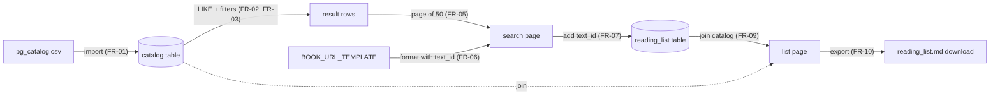

No data leaves the machine. The server opens no sockets to other hosts.
```

## docs/diagrams/09_erd.md

```markdown
# Entity relationship diagram

Covers: FR-01, FR-07, FR-09

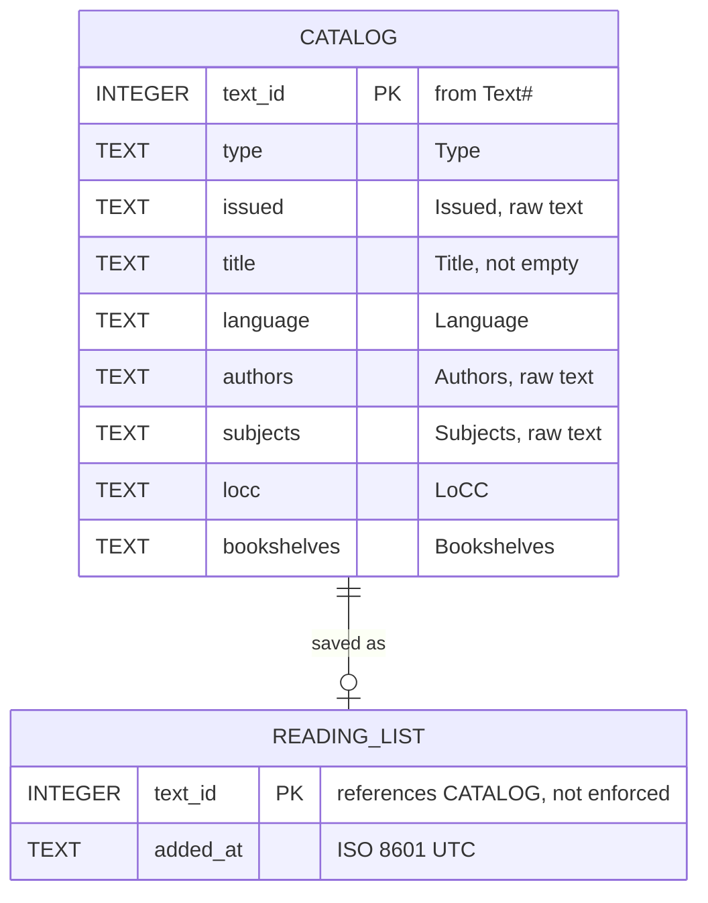

Notes:
- The foreign key is not enforced. Import deletes catalog rows but keeps list rows (AC-01.3).
- A list row whose book is gone after refresh shows "no longer in catalog" on the list page.
- Indexes: `catalog(language)`, `catalog(type)`, `catalog(title)`. LIKE with a leading `%` does not use them.
```

## docs/diagrams/10_state.md

```markdown
# State diagrams

## Catalog state

Covers: FR-01, FR-11, NFR-R1

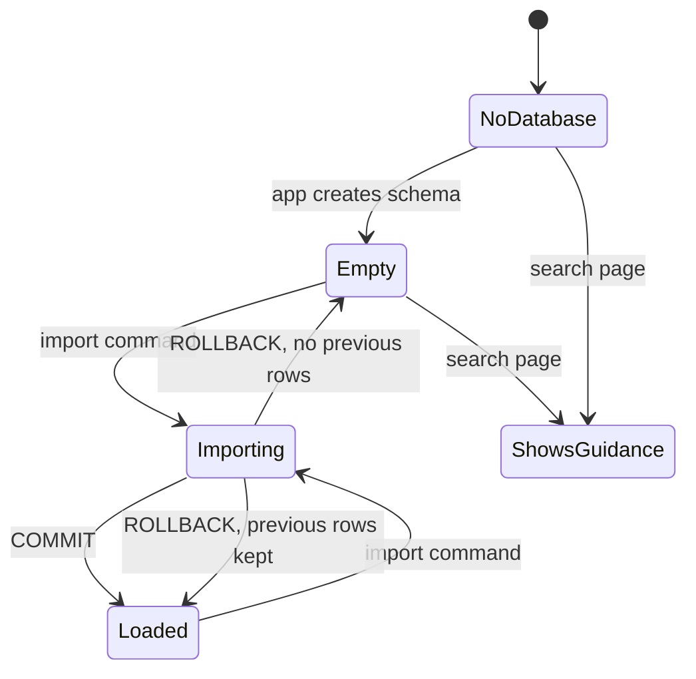

## Reading list item state

Covers: FR-07, FR-08

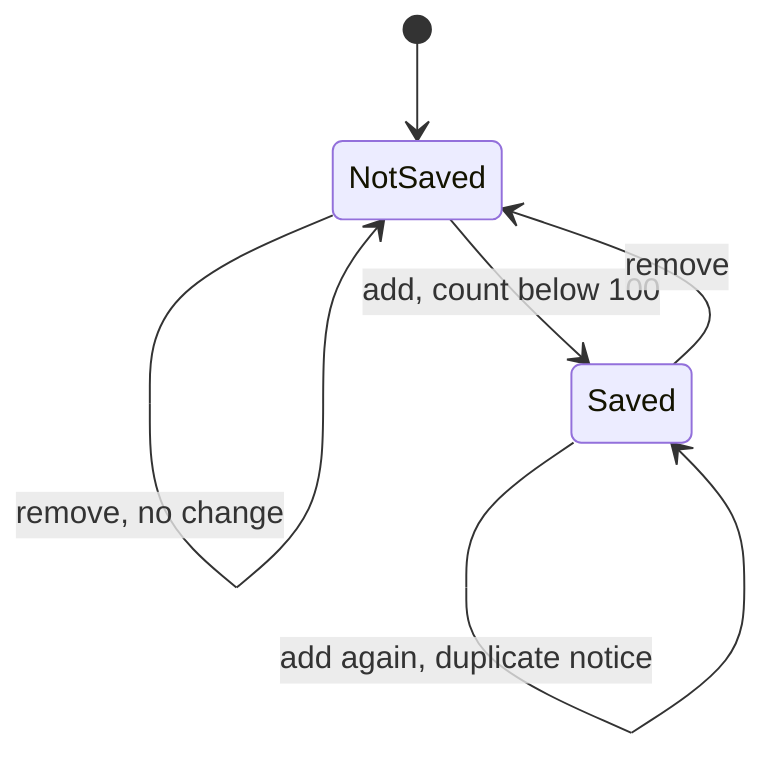
```

## docs/diagrams/11_class.md

```markdown
# Class diagram

Covers: FR-01 to FR-11

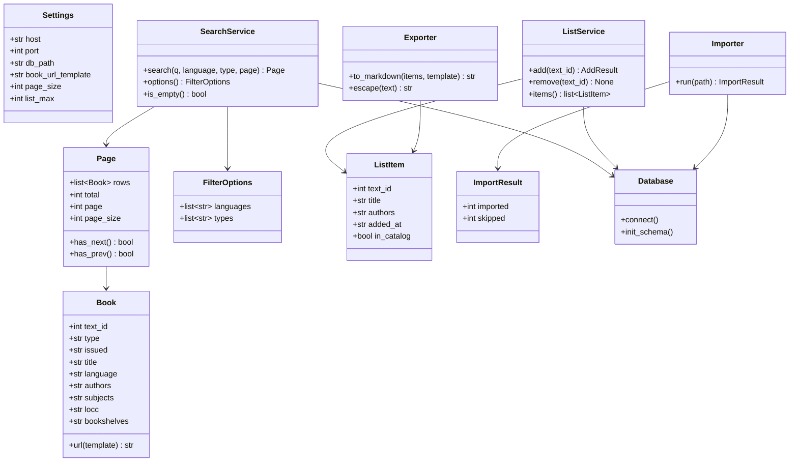
```

## docs/diagrams/12_gui_mockup.md

```markdown
# GUI mockup

Covers: FR-02, FR-03, FR-04, FR-05, FR-06, FR-07, FR-08, FR-09, FR-10, FR-11, NFR-A1, NFR-A3

Two pages. Plain HTML, one small CSS file, no JavaScript required.

## Search page /search

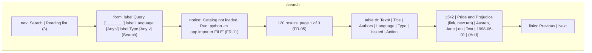

## Reading list page /list

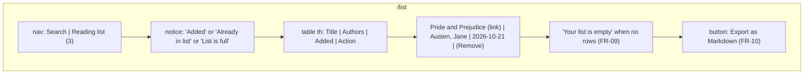
```

## docs/ARCHITECTURE.md

```markdown
# Architecture

Version 0.1. Derived from docs/PRD.md. Diagrams live in docs/diagrams/.

## 1. Shape

- One Python 3.12 process runs FastAPI with Jinja2 templates.
- One SQLite file at [DB_PATH] holds two tables: `catalog` and `reading_list`.
- One CLI module imports the CSV. The web app never imports.
- The server binds to 127.0.0.1 and makes no outbound calls.
- The browser follows result links to gutenberg.org on its own.

## 2. Modules

| Module | Role | FRs |
|--------|------|-----|
| app/settings.py | Read .env into a Settings object | NFR-S4 |
| app/db.py | Connection, schema, indexes | FR-01, FR-11 |
| app/importer.py | CLI import, batching, skip rules | FR-01 |
| app/services/search.py | Query, filters, options, paging | FR-02 to FR-05, FR-11 |
| app/services/reading_list.py | Add, remove, list | FR-07 to FR-09 |
| app/services/export.py | Markdown text, escaping | FR-10 |
| app/routers/*.py | HTTP routes, template rendering | FR-05, FR-06 |
| app/templates/*.html | Pages, labels, tables | NFR-A1 to A3 |

## 3. Key decisions

| Decision | Choice | Why |
|----------|--------|-----|
| Search | SQL LIKE on three columns | Simple, no extra tables. 80k rows scan fast. See risk R2. |
| Paging | OFFSET and LIMIT | Fine at this size. Offsets past 80k are still cheap. |
| Frontend | Server-rendered HTML forms | No build step. Works without JS. Fewer agent mistakes. |
| Refresh | DELETE then INSERT in one transaction | Atomic. Keeps reading_list rows. |
| Book URL | Setting with `{id}` placeholder | Pattern is UNVERIFIED. Owner can fix it in .env. |
| Secrets | None today. .env still used for settings | Keeps the hard filter honest. |

## 4. Theory note

The core operation is a filtered substring search over n rows.
Without a full-text index, SQLite must scan every row and test LIKE on three text fields.
This is linear in n and in total text length. For n near 80,000 this is well under a second.
A B-tree index on `title` helps `ORDER BY title` but cannot help a `%x%` pattern.
FTS5 would give O(log n + r) lookups for whole-word search, but changes semantics and adds a table.
Tradeoff: accept linear scans now, measure, switch to FTS5 only if NFR-P1 fails.

## 5. Big-O table

Symbols:
- n: number of catalog rows (about 79,600).
- L: average total characters in Title, Authors and Subjects per row.
- q: length of the query string.
- r: number of rows that match the query and filters.
- p: page size, fixed at 50.
- m: number of items in the reading list, at most 100.
- d: number of distinct Language or Type values.
- f: number of lines in the CSV file.

| Operation | Time | Space | Note |
|-----------|------|-------|------|
| Import CSV | O(f) | O(1) extra, streamed | One transaction, batches of 1000 |
| Search count | O(n * L) | O(1) | Full scan, LIKE on 3 columns |
| Search page | O(n * L + r log r) | O(p) | Sort by title, then OFFSET and LIMIT |
| Filter only, no query | O(n) | O(p) | Index on language or type may reduce to O(r) |
| Filter options | O(n) | O(d) | DISTINCT scan; cache per request |
| Add to list | O(log n + m) | O(1) | PK lookup plus count |
| Remove from list | O(log m) | O(1) | PK delete |
| View list | O(m log n) | O(m) | Join each item to catalog by PK |
| Export Markdown | O(m * L) | O(m * L) | Build one string |
| Escape title | O(L) | O(L) | Replace `]` and `\` |

Query length q only affects the LIKE constant factor and is omitted from the big terms.

## 6. FR to diagram table

| FR | Diagrams |
|----|----------|
| FR-01 | 01, 02, 03, 07, 08, 09, 10, 11 |
| FR-02 | 01, 02, 03, 04, 08, 11, 12 |
| FR-03 | 01, 02, 03, 04, 08, 11, 12 |
| FR-04 | 01, 02, 03, 04, 11, 12 |
| FR-05 | 01, 02, 03, 04, 08, 11, 12 |
| FR-06 | 01, 02, 03, 04, 08, 11, 12 |
| FR-07 | 01, 02, 03, 05, 08, 09, 10, 11, 12 |
| FR-08 | 01, 02, 03, 05, 10, 11, 12 |
| FR-09 | 01, 02, 03, 05, 06, 08, 09, 11, 12 |
| FR-10 | 01, 02, 03, 06, 08, 11, 12 |
| FR-11 | 01, 02, 03, 04, 10, 11, 12 |
```

Gate check:
- Every FR appears in at least one diagram. Yes, see the table in ARCHITECTURE.md section 6.
- Mermaid syntax: all labels with parentheses, colons or quotes are wrapped in double quotes. Diagram types used are flowchart, sequenceDiagram, erDiagram, stateDiagram-v2 and classDiagram. I have not run a renderer today, so "renders without errors" is UNVERIFIED until you paste one into https://mermaid.live or your editor.
- Big-O table defines every symbol (n, L, q, r, p, m, d, f).

Gate: PASS, with one UNVERIFIED note on rendering. Please paste one diagram into a renderer and report any error.

Reply "continue" for Phase 4 (guides and agent rules), or list changes first.

---
## Turn 4 (2026-10-21T20:06:18-07:00)
### User
```
Accepted, continue to the next phase.
```
### Usage
{"input_tokens": 4, "cache_creation_input_tokens": 7452, "cache_read_input_tokens": 10846, "cache_creation": {"ephemeral_5m_input_tokens": 7452, "ephemeral_1h_input_tokens": 0}, "output_tokens": 4919, "service_tier": "standard", "inference_geo": "global", "speed": "standard", "output_tokens_details": {"thinking_tokens": 401}}
Stop: end_turn. Cost: $0.34999
### Assistant

# Artifact 4: Guides and agent context files

No code in this message. Phase 4 only. Config and docs files only.

## docs/README.md

```markdown
# Documentation index and reading order

Read in this order. Each file assumes the ones above it.

1. docs/brief.md. The owner's brief, verbatim.
2. docs/ASSUMPTIONS.md. Accepted defaults for every unknown.
3. docs/PRD.md. Source of truth for behavior. FR-01 to FR-11 with acceptance criteria.
4. docs/ARCHITECTURE.md. Modules, decisions, Big-O table, FR to diagram table.
5. docs/diagrams/01 to 12. Mermaid diagrams. Open the one named in your task.
6. docs/SETUP.md. Install, settings, run, test.
7. docs/CONTRIBUTING.md. Branches, commits, style, review.
8. docs/TESTING.md. Test layout, coverage target, demo script.
9. docs/TASKS.md. Ordered tasks with FR IDs and tests (Phase 5, not yet written).
10. docs/CONTEXT_BUDGET.md. Prompt order for coding turns (Phase 6, not yet written).
11. PROGRESS.md. Current phase, done, next, blockers.

Agent rules live at the repo root and are short indexes: AGENTS.md, CLAUDE.md, .cursor/rules/.
They point here. They do not restate the PRD.
```

## docs/SETUP.md

```markdown
# Setup

## Requirements

- Python 3.12. Version not verified today; use the version you have and record it in PROGRESS.md.
- pip. No other package manager is used.
- A local copy of pg_catalog.csv from https://www.gutenberg.org/cache/epub/feeds/pg_catalog.csv

## Install

```
python -m venv .venv
source .venv/bin/activate        # Windows: .venv\Scripts\activate
pip install -r requirements.txt
cp .env.example .env
```

requirements.txt is created in Phase 5 task 1. It pins exact versions of:
fastapi, uvicorn, jinja2, python-dotenv, python-multipart, pytest, pytest-cov, httpx.
Versions are [PIN] until the task runs `pip index versions` and records what it found.

## Settings (.env)

Names only. Values go in .env, which is in .gitignore.

| Name | Meaning | Default used by the app if unset |
|------|---------|----------------------------------|
| HOST | Bind address | 127.0.0.1 |
| PORT | Port | 8000 |
| DB_PATH | SQLite file path | data/catalog.db |
| BOOK_URL_TEMPLATE | Link pattern with `{id}` | https://www.gutenberg.org/ebooks/{id} (UNVERIFIED) |
| PAGE_SIZE | Rows per page | 50 |
| LIST_MAX | Max reading list items | 100 |

No secrets exist today. The .env rule still applies to every future setting.

## Load the catalog

```
python -m app.importer path/to/pg_catalog.csv
```

Prints "imported N, skipped M". Exits non-zero on bad encoding or a missing column.

## Run

```
uvicorn app.main:app --host 127.0.0.1 --port 8000
```

Open http://127.0.0.1:8000/search

## Test

```
pytest
pytest --cov=app --cov-report=term-missing
```

See docs/TESTING.md.
```

## docs/CONTRIBUTING.md

```markdown
# Contributing

## Before any change

1. Read docs/PRD.md. Find the FR ID your change touches.
2. Read the diagram listed for that FR in docs/ARCHITECTURE.md section 6.
3. Read the task in docs/TASKS.md. Do only that task.

## Branches and commits

- One branch per task: `task-NN-short-name`.
- Commit message first line: `FR-NN: what changed` in under 60 characters.
- No tool credit lines in commit messages or files. No "Generated by" or "Co-authored-by" tool lines.

## Code style

- Python 3.12, type hints on every function signature.
- Format with black and sort imports with isort, both pinned in requirements.txt.
- Line length 100.
- No em dashes or en dashes in any file, comment, or string. Use a hyphen or a comma.
- Templates: every form control has a `<label for=...>`. Use `<main>`, `<nav>`, `<th>`.

## Never do

The single never-do list is in AGENTS.md. Do not copy it; read it.

## Review checklist

- [ ] Task's test exists and passes.
- [ ] Coverage stays at or above 80 percent.
- [ ] No new dependency without a pinned version and a line in docs/SETUP.md.
- [ ] PROGRESS.md updated: date, phase, done, next, blockers.
- [ ] Behavior matches the FR text. If it cannot, change the PRD first, then the code.
```

## docs/TESTING.md

```markdown
# Testing

## Runner

pytest with pytest-cov. Web routes use FastAPI's TestClient (httpx).

## Layout

```
tests/
  conftest.py          fixtures: temp DB, sample CSV, TestClient
  fixtures/
    sample.csv         12 rows: 2 languages, 2 types, quoted fields, a newline in a field,
                       2 rows with empty Title, 1 row with empty Text#
    bad_encoding.csv   latin-1 bytes that are not valid UTF-8
    missing_column.csv header without Subjects
  test_importer.py     FR-01
  test_search.py       FR-02, FR-03, FR-04, FR-05, FR-11
  test_links.py        FR-06
  test_reading_list.py FR-07, FR-08, FR-09
  test_export.py       FR-10
  test_security.py     NFR-S2 (no outbound sockets), NFR-S3 (no f-string SQL)
  test_perf.py         NFR-P1, NFR-P2, marked `slow`, needs the full CSV path in PERF_CSV
```

## Naming

One test per acceptance criterion: `test_ac_02_1_title_substring`.
A failing test must name the AC in its assertion message.

## Coverage

Target: 80 percent of `app/`. Command:

```
pytest --cov=app --cov-fail-under=80
```

The `slow` marker is skipped by default: `pytest -m "not slow"` is the default addopts.
Run `pytest -m slow` with `PERF_CSV=path/to/pg_catalog.csv` to check NFR-P1 and NFR-P2.

## Demo script

`scripts/demo.sh` (created in Phase 5):
1. Creates a temp DB from tests/fixtures/sample.csv.
2. Starts the server on port 8000.
3. Prints three URLs to try: a search, the list, the export.
Stop with Ctrl+C. The script removes the temp DB.

## Every external claim in tests

Expected URLs use BOOK_URL_TEMPLATE from settings, never a hard-coded gutenberg.org string,
because the pattern is UNVERIFIED.
```

## PROGRESS.md

```markdown
# Progress

| Date | Phase | Done | Next | Blockers |
|------|-------|------|------|----------|
| 2026-10-21 | 1 | Assumptions accepted | PRD | none |
| 2026-10-21 | 2 | PRD v0.1, FR-01 to FR-11 | Diagrams | none |
| 2026-10-21 | 3 | 12 diagrams, ARCHITECTURE.md | Guides and rules | Mermaid render UNVERIFIED |
| 2026-10-21 | 4 | Guides, AGENTS.md, CLAUDE.md, Cursor rules | TASKS.md | Book URL UNVERIFIED |

Rules for this file: add one row per turn. Never delete rows. Dates are the date of the turn.
```

## .env.example

```
HOST=
PORT=
DB_PATH=
BOOK_URL_TEMPLATE=
PAGE_SIZE=
LIST_MAX=
```

## .gitignore

```
.env
.venv/
__pycache__/
*.pyc
data/*.db
.pytest_cache/
.coverage
htmlcov/
```

## AGENTS.md

```markdown
# Agent rules (shared by every agent)

Read docs/PRD.md before changing behavior. Read docs/README.md for the full reading order.
Do only the task in docs/TASKS.md that you were given. Stop and ask if the task is unclear.

## Commands

- Install: `pip install -r requirements.txt`
- Test: `pytest --cov=app --cov-fail-under=80`
- Run: `uvicorn app.main:app --host 127.0.0.1 --port 8000`
- Import: `python -m app.importer FILE.csv`

## Code style

Python 3.12, type hints, black, isort, line length 100. Details: docs/CONTRIBUTING.md.

## Never do

1. Never put a secret or a setting value in code. Read them from .env via app/settings.py.
2. Never commit .env. Never put values in .env.example.
3. Never add a dependency without an exact pinned version in requirements.txt.
4. Never build SQL with f-strings, format, or concatenation. Use `?` parameters.
5. Never make an outbound network call from the server. No CDNs, no fetch, no requests.
6. Never add a JavaScript build step or a frontend framework. Server-rendered HTML only.
7. Never use an em dash or en dash in any file, comment, string, or commit.
8. Never add tool credit lines ("Generated by", "Co-authored-by" tools) to files or commits.
9. Never write code for an FR that is not in docs/PRD.md. Propose a PRD change instead.
10. Never claim a URL, version, or API fact you did not verify. Mark it UNVERIFIED.
11. Never commit catalog data or .db files.

## Done means

The task's test passes, coverage is at or above 80 percent, and PROGRESS.md has a new row.
```

(28 lines.)

## CLAUDE.md

```markdown
# Claude Code index

This file is an index. Rules are in @AGENTS.md. Do not duplicate them here.

@AGENTS.md
@docs/README.md

Before coding: read docs/PRD.md, then docs/TASKS.md, then the diagram named in your task.
After coding: run `pytest --cov=app --cov-fail-under=80` and add a row to PROGRESS.md.

Note: the `@path` import syntax is described in the project workflow. Its exact behavior
in the current Claude Code release is UNVERIFIED today. If imports do not load, open the
two files above by hand.
```

(11 lines.)

## .cursor/rules/project.mdc

```markdown
---
description: Project rules for the Gutenberg catalog browser
alwaysApply: true
---

Rules are in AGENTS.md at the repo root. Read it first. Do not duplicate it.
Read docs/PRD.md before changing behavior. Do only the task from docs/TASKS.md.
Test command: `pytest --cov=app --cov-fail-under=80`.
```

(9 lines.)

## .cursor/rules/templates.mdc

```markdown
---
description: Rules for Jinja2 templates
globs: app/templates/**/*.html
alwaysApply: false
---

Every form control needs a `<label for=...>`. Use `<main>`, `<nav>`, and `<th>` in tables.
Autoescape stays on. Result links get `target="_blank" rel="noopener"`.
No inline scripts, no external stylesheets or scripts. See docs/PRD.md NFR-A1 to A3, NFR-S5.
```

(9 lines.)

Note on the .mdc frontmatter keys (`description`, `globs`, `alwaysApply`): taken from the project workflow text. Not read from Cursor's docs today, so UNVERIFIED. If Cursor ignores a file, check the key names in its current docs.

Gate check:
- Each rules file under 150 lines: AGENTS.md 28, CLAUDE.md 11, project.mdc 9, templates.mdc 9.
- One context file per agent: Claude Code (CLAUDE.md), Cursor (.cursor/rules). AGENTS.md is shared.
- Duplicated facts: the test command appears in AGENTS.md, CLAUDE.md, and project.mdc. This is the one allowed pointer-level repeat so each agent can run tests without opening another file. The never-do list exists only in AGENTS.md.
- .env in .gitignore: yes. .env.example has names only: yes. No secret appears in any file.
- SETUP.md lists .env variables by name only.
- External facts: Cursor frontmatter and Claude @path marked UNVERIFIED. Dependency versions are [PIN].

Gate: PASS

Reply "continue" for Phase 5 (docs/TASKS.md). After that artifact, your written "approved" is the only thing that starts code.

---
## Turn 5 (2026-10-21T20:07:21-07:00)
### User
```
Accepted, continue to the next phase.
```
### Usage
{"input_tokens": 4, "cache_creation_input_tokens": 4533, "cache_read_input_tokens": 18298, "cache_creation": {"ephemeral_5m_input_tokens": 4533, "ephemeral_1h_input_tokens": 0}, "output_tokens": 4957, "service_tier": "standard", "inference_geo": "global", "speed": "standard", "output_tokens_details": {"thinking_tokens": 90}}
Stop: end_turn. Cost: $0.32285
### Assistant

# Artifact 5: Task plan

No code in this message. Phase 5 only. Code starts at task 1 only after your written "approved".

## docs/TASKS.md

```markdown
# Tasks

Version 0.1. Status: waiting for owner approval. Derived from docs/PRD.md and docs/ARCHITECTURE.md.

Rules:
- Do tasks in order. One task per agent turn. Do not start the next task in the same turn.
- Each task lists the FRs it serves, the files it touches, its test, and its done check.
- "Test" names the pytest tests that must pass. Earlier tests must keep passing.
- Every task ends with a new row in PROGRESS.md.
- If a task cannot meet the FR text, stop and propose a PRD change. Do not bend the code.

## Task list

### T-01 Project skeleton and pinned dependencies
- FRs: none (supports all). NFR-S4, NFR-S6.
- Files: requirements.txt, pyproject.toml (black, isort, pytest config), app/__init__.py,
  tests/__init__.py, tests/conftest.py (empty fixtures for now), scripts/ (empty).
- Steps: run `pip index versions NAME` for fastapi, uvicorn, jinja2, python-dotenv,
  python-multipart, pytest, pytest-cov, httpx, black, isort. Pin the latest stable found.
  Record the versions and the Python version in PROGRESS.md.
- Test: `pytest` runs and reports 0 tests, exit code 0. `pytest -m "not slow"` is the default.
- Done: install works from a clean venv per docs/SETUP.md.

### T-02 Settings from .env
- FRs: NFR-S4, FR-06 (template setting).
- Files: app/settings.py, tests/test_settings.py.
- Behavior: read HOST, PORT, DB_PATH, BOOK_URL_TEMPLATE, PAGE_SIZE, LIST_MAX. Apply the
  defaults in docs/SETUP.md when unset. PORT, PAGE_SIZE, LIST_MAX are ints.
- Test: test_settings_defaults, test_settings_env_override, test_settings_bad_int_raises.
- Done: no setting value appears anywhere in app/ except as a default in settings.py.

### T-03 Database connection and schema
- FRs: FR-01, FR-11. NFR-S3.
- Files: app/db.py, tests/test_db.py.
- Behavior: connect(db_path) returns a sqlite3 connection with row_factory set.
  init_schema() creates catalog and reading_list per docs/diagrams/09_erd.md plus three indexes.
  Creates the parent folder of DB_PATH if missing. Idempotent.
- Test: test_init_schema_creates_tables, test_init_schema_twice_is_safe, test_indexes_exist.
- Done: schema matches the ERD column by column.

### T-04 Test fixtures
- FRs: supports FR-01 to FR-11.
- Files: tests/fixtures/sample.csv, tests/fixtures/bad_encoding.csv,
  tests/fixtures/missing_column.csv, tests/conftest.py.
- Behavior: sample.csv has 12 rows per docs/TESTING.md. conftest gives `tmp_db`, `sample_csv`,
  `loaded_db` (schema plus sample rows), and `client` (TestClient with env pointing at tmp_db).
- Test: test_fixture_sample_has_12_rows (counts with csv module).
- Done: fixtures contain no real secrets and no em or en dashes.

### T-05 Importer: happy path and skip rules
- FRs: FR-01 (AC-01.1, AC-01.2, AC-01.3, AC-01.4). NFR-P3, NFR-R1.
- Files: app/importer.py, tests/test_importer.py.
- Behavior: `python -m app.importer FILE`. Stream rows with csv.DictReader. Batches of 1000
  via executemany. One transaction: DELETE FROM catalog, then inserts, then COMMIT.
  Skip rows with empty Text# or empty Title. Print "imported N, skipped M". Exit 0.
- Test: test_ac_01_1_imports_rows, test_ac_01_2_replaces_rows, test_ac_01_3_keeps_list,
  test_ac_01_4_skips_and_counts.
- Done: a second import of the same file gives the same counts.

### T-06 Importer: error paths and atomicity
- FRs: FR-01 (AC-01.5, AC-01.6). NFR-R1.
- Files: app/importer.py, tests/test_importer.py.
- Behavior: non UTF-8 file exits 1 with "not valid UTF-8". Missing column exits 1 and names it.
  Any exception mid-import triggers ROLLBACK; old rows remain.
- Test: test_ac_01_5_bad_encoding_exit_1, test_ac_01_6_missing_column_named,
  test_nfr_r1_failure_keeps_old_rows (inject a failing batch with monkeypatch).
- Done: no partial catalog state is reachable.

### T-07 SearchService: query matching
- FRs: FR-02, FR-11.
- Files: app/services/search.py, tests/test_search.py.
- Behavior: search(q, language, type, page) returns Page. LIKE with ESCAPE on title, authors,
  subjects, case-insensitive. Escape `%`, `_`, and the escape char in q. Empty q and empty
  filters returns an empty Page with total 0 and a flag `needs_query`. is_empty() reports an
  empty catalog. Raise CatalogEmpty when the table has no rows.
- Test: test_ac_02_1 to test_ac_02_6, test_ac_11_2_empty_catalog_raises.
- Done: every SQL statement uses `?` parameters. test_security will check this later.

### T-08 SearchService: filters and options
- FRs: FR-03, FR-04.
- Files: app/services/search.py, tests/test_search.py.
- Behavior: language and type add `AND column = ?`. options() returns sorted distinct
  non-empty languages and types.
- Test: test_ac_03_1 to test_ac_03_4, test_ac_04_1_distinct_sorted, test_ac_04_2_empty_catalog.
- Done: filters with empty q return rows (AC-03.4).

### T-09 SearchService: pagination
- FRs: FR-05.
- Files: app/services/search.py, app/models.py (Book, Page), tests/test_search.py.
- Behavior: COUNT first, then SELECT ORDER BY title LIMIT ? OFFSET ?. Page has total, page,
  page_size, has_next(), has_prev(). Page 0, negative, or non-integer becomes 1.
- Test: test_ac_05_1_first_page, test_ac_05_2_last_page, test_ac_05_3_beyond_last,
  test_ac_05_4_bad_page_number. Needs a fixture that inserts 120 generated rows.
- Done: paging math is in one function with its own unit test.

### T-10 FastAPI app, base template, search page
- FRs: FR-02 to FR-06, FR-11. NFR-A1 to A3, NFR-S1, NFR-S5.
- Files: app/main.py, app/routers/search.py, app/templates/base.html,
  app/templates/search.html, app/static/style.css, tests/test_search_page.py,
  tests/test_links.py.
- Behavior: GET /search renders the form, options, notice, count, table, paging links.
  GET / redirects to /search. Links use Book.url(template), `target="_blank" rel="noopener"`.
  Missing DB file or empty catalog shows "Catalog not loaded" and the import command.
- Test: test_search_page_renders_labels, test_ac_06_1_default_href, test_ac_06_2_custom_template,
  test_ac_06_3_noopener, test_ac_11_1_no_db_file, test_ac_11_2_empty_catalog_page,
  test_ac_05_1_count_text, test_ac_02_4_no_results_text, test_ac_02_5_prompt_text.
- Done: page validates as HTML with `<main>`, `<nav>`, and `<th>`.

### T-11 ListService: add and remove
- FRs: FR-07, FR-08.
- Files: app/services/reading_list.py, tests/test_reading_list.py.
- Behavior: add(text_id) returns Added, Duplicate, ListFull, or raises NotFound.
  Checks catalog by PK, then count against LIST_MAX, then INSERT OR IGNORE with UTC added_at.
  remove(text_id) deletes; no error if absent.
- Test: test_ac_07_1 to test_ac_07_4, test_ac_08_1, test_ac_08_2.
- Done: add is safe to call twice.

### T-12 ListService: items, list page, add and remove routes
- FRs: FR-07, FR-08, FR-09.
- Files: app/services/reading_list.py, app/routers/reading_list.py,
  app/templates/list.html, tests/test_reading_list.py, tests/test_list_page.py.
- Behavior: items() joins reading_list to catalog, ordered by added_at. in_catalog is False
  when the join misses; the page shows "no longer in catalog". POST /list/add and
  POST /list/remove take form field text_id and redirect 303 to /list with a notice in the
  query string. Nav shows the list count.
- Test: test_ac_09_1_order, test_ac_09_2_empty_text, test_add_route_redirects,
  test_add_full_notice, test_add_missing_404, test_remove_route, test_item_missing_after_refresh.
- Done: notice text is plain, escaped, and never contains user HTML.

### T-13 Exporter and export route
- FRs: FR-10.
- Files: app/services/export.py, app/routers/export.py, tests/test_export.py.
- Behavior: to_markdown(items, template) returns "# Reading list" then one bullet per item:
  `- [Title](link) by Authors`. escape() replaces `\` with `\\` and `]` with `\]` in titles.
  Empty list gives the heading and "No books saved." GET /list/export.md returns
  Content-Type text/markdown and Content-Disposition attachment; filename=reading_list.md.
- Test: test_ac_10_1_two_bullets, test_ac_10_2_exact_line, test_ac_10_3_empty,
  test_ac_10_4_escape_bracket.
- Done: exact line match in AC-10.2 uses the template from settings.

### T-14 Security tests
- FRs: NFR-S2, NFR-S3.
- Files: tests/test_security.py.
- Behavior: NFR-S2: monkeypatch socket.socket.connect to raise; run a search, list, export
  through TestClient; assert no raise. NFR-S3: scan app/ source with ast for f-strings,
  `.format`, or `+` whose result is passed to execute or executemany; assert none.
- Test: test_nfr_s2_no_outbound_connect, test_nfr_s3_no_string_built_sql.
- Done: both tests pass without changes to app/. If not, fix app/ and note the FR.

### T-15 Performance tests, slow marker
- FRs: NFR-P1, NFR-P2.
- Files: tests/test_perf.py, pyproject.toml (marker registration).
- Behavior: skip unless PERF_CSV is set. Import the full file, assert under 120 s.
  Run three searches ("austen", "fiction", "the") twice each, assert the second run of
  each is under 500 ms. Print timings.
- Test: test_nfr_p2_import_time, test_nfr_p1_search_time.
- Done: results recorded in PROGRESS.md. If NFR-P1 fails, open a PRD change for FTS5 (risk R2).

### T-16 Demo script and docs sync
- FRs: supports all. docs/TESTING.md demo section.
- Files: scripts/demo.sh, docs/SETUP.md (versions), PROGRESS.md.
- Behavior: scripts/demo.sh per docs/TESTING.md. Replace [PIN] in docs/SETUP.md with the
  versions from T-01. Owner verifies one book link by hand and marks BOOK_URL_TEMPLATE
  verified or changes it.
- Test: `bash -n scripts/demo.sh` passes. Full `pytest --cov=app --cov-fail-under=80` passes.
- Done: a stranger can follow docs/SETUP.md end to end.

## Coverage of FRs

| FR | Tasks |
|----|-------|
| FR-01 | T-03, T-05, T-06 |
| FR-02 | T-07, T-10 |
| FR-03 | T-08, T-10 |
| FR-04 | T-08, T-10 |
| FR-05 | T-09, T-10 |
| FR-06 | T-02, T-10 |
| FR-07 | T-11, T-12 |
| FR-08 | T-11, T-12 |
| FR-09 | T-12 |
| FR-10 | T-13 |
| FR-11 | T-03, T-07, T-10 |
| NFR-S1 to S6 | T-01, T-02, T-10, T-14 |
| NFR-P1 to P3 | T-05, T-15 |
| NFR-A1 to A4 | T-10, T-12 |
| NFR-R1 | T-05, T-06 |
```

Gate check:
- Every FR maps to at least one task and each task names its tests.
- Each task touches a few files and fits one agent turn.
- Tasks are ordered so each one only depends on earlier ones.

Gate: FAIL, because the owner has not written "approved".

Reply "approved" to accept this plan. I will then produce Phase 6 (docs/CONTEXT_BUDGET.md) and Phase 7 (Objections) as documents, and code starts at T-01 only after those, when you say so. Or reply "continue" if you want Phases 6 and 7 before giving approval.

---
## Turn 6 (2026-10-21T20:08:19-07:00)
### User
```
approved. For this test, do not write code in this chat. Continue with Phase 6, then Phase 7, then the final message, one artifact per message.
```
### Usage
{"input_tokens": 4, "cache_creation_input_tokens": 4914, "cache_read_input_tokens": 22831, "cache_creation": {"ephemeral_5m_input_tokens": 4914, "ephemeral_1h_input_tokens": 0}, "output_tokens": 2322, "service_tier": "standard", "inference_geo": "global", "speed": "standard", "output_tokens_details": {"thinking_tokens": 324}}
Stop: end_turn. Cost: $0.2004
### Assistant

# Artifact 6: Token plan

No code in this message. Phase 6 only. Approval is recorded; coding will not start in this chat per your instruction.

## docs/CONTEXT_BUDGET.md

```markdown
# Context budget and prompt order

Version 0.1. Purpose: every coding turn sends the same stable prefix so the provider can
reuse a cached prompt. Only the tail changes.

## 1. Order for every coding prompt

| Slot | Content | Changes per turn? |
|------|---------|-------------------|
| 1 | AGENTS.md | No |
| 2 | docs/PRD.md | No, unless the PRD version changes |
| 3 | docs/ARCHITECTURE.md | No, unless the version changes |
| 4 | The one diagram file named in the task | Yes, per task |
| 5 | The one task block from docs/TASKS.md | Yes, per task |
| 6 | The current file or files being edited | Yes |
| 7 | The request, one or two sentences | Yes |

Slots 1 to 3 are the stable prefix. Keep them byte for byte identical across turns.
Do not add dates, counters, greetings, or the PROGRESS.md table before slot 4.
PROGRESS.md is read by the agent from disk when it needs it. It is never pasted into the prefix.

## 2. Rules that protect the cache

- Paste files in the fixed order above. Never reorder.
- Paste whole files, not excerpts, for slots 1 to 3. Excerpts drift between turns.
- Do not edit AGENTS.md, PRD.md, or ARCHITECTURE.md during a coding task.
  If a change is needed, finish the task, change the doc, then start a new cache epoch.
- Put the request last. Long context first, question last, per the project method.
- Keep slots 4 to 7 as small as possible. One diagram, one task, one or two files.

## 3. Template to paste

Copy this block. Replace the bracketed parts. Keep everything else exactly as written.

```
<rules>
[PASTE: full contents of AGENTS.md]
</rules>

<prd>
[PASTE: full contents of docs/PRD.md]
</prd>

<architecture>
[PASTE: full contents of docs/ARCHITECTURE.md]
</architecture>

<diagram>
[PASTE: full contents of docs/diagrams/NN_name.md named in the task]
</diagram>

<task>
[PASTE: the single T-NN block from docs/TASKS.md]
</task>

<current_files>
[PASTE: each file the task says it touches, with its path as a heading, or "none yet"]
</current_files>

<request>
Do task T-NN only. Write the listed tests first, then the code, then run the test command
from AGENTS.md. Add one row to PROGRESS.md. Stop after that and report results.
</request>
```

## 4. Size estimate

Rough token counts, measured by word count times 1.3. UNVERIFIED until measured with the
provider's token counter.

| Slot | Approx tokens |
|------|---------------|
| AGENTS.md | 450 |
| docs/PRD.md | 3,200 |
| docs/ARCHITECTURE.md | 1,400 |
| Stable prefix total | about 5,000 |
| One diagram | 300 to 600 |
| One task block | 150 to 250 |
| Current files | 0 to 3,000 |
| Request | 50 |

The stable prefix is above the minimum cacheable size for the providers listed below,
if the recalled minimums are correct.

## 5. Provider caching facts

I could not open a browser today. Every fact below is recalled, not read, and is UNVERIFIED.
Check each link before relying on the numbers and update this table with the date checked.

| Provider | Use in this project | Minimum cacheable prefix | Cache lifetime | Source | Status |
|----------|---------------------|--------------------------|----------------|--------|--------|
| Anthropic (Claude Code) | Primary | [MIN_TOKENS_ANTHROPIC], recalled as about 1,024 tokens for larger models | [TTL_ANTHROPIC], recalled as about 5 minutes, refreshed on each hit, with a longer paid option | https://docs.anthropic.com/en/docs/build-with-claude/prompt-caching | UNVERIFIED |
| OpenAI (if used via Cursor) | Secondary | [MIN_TOKENS_OPENAI], recalled as about 1,024 tokens | [TTL_OPENAI], recalled as minutes, not hours | https://platform.openai.com/docs/guides/prompt-caching | UNVERIFIED |
| Cursor's own handling | Cursor | Not documented to me | Not documented to me | https://docs.cursor.com | UNVERIFIED |

Claude Code reads CLAUDE.md and AGENTS.md from disk on its own. The paste template above is
for direct chat or API use. In Claude Code, keep the same file order in your request text:
name the diagram, name the task, then give the request.

## 6. Checklist per turn

- [ ] Slots 1 to 3 unchanged since the last turn (diff them if unsure).
- [ ] Exactly one task in slot 5.
- [ ] Request is last and under three sentences.
- [ ] No timestamps anywhere before slot 4.
- [ ] After the turn, update PROGRESS.md on disk, not in the prompt.
```

Gate check:
- The order is written as a template the user can paste. Yes, section 3.
- Stable prefix is fixed and dated content is excluded from it.
- Caching facts: all labeled UNVERIFIED with links and bracketed variables, since I did not read the provider docs today.

Gate: PASS, with the caching numbers marked UNVERIFIED pending your check of the three links.

Reply "continue" for Phase 7 (Objections).

---
## Turn 7 (2026-10-21T20:08:50-07:00)
### User
```
Accepted, continue to the next phase.
```
### Usage
{"input_tokens": 4, "cache_creation_input_tokens": 2013, "cache_read_input_tokens": 27745, "cache_creation": {"ephemeral_5m_input_tokens": 2013, "ephemeral_1h_input_tokens": 0}, "output_tokens": 5470, "service_tier": "standard", "inference_geo": "global", "speed": "standard", "output_tokens_details": {"thinking_tokens": 2020}}
Stop: end_turn. Cost: $0.32645
### Assistant

# Artifact 7: Objections

No code in this message. Phase 7 only. I reviewed the full set as a doubtful senior reviewer joining tomorrow. Seven gaps found. Each is fixed below by a document change. Patch blocks show only the changed sections and name the section they replace.

## docs/OBJECTIONS.md

```markdown
# Skeptic pass: objections and fixes

Date of pass: 2026-10-21. Reviewer stance: a senior engineer who has not seen the chat.

| ID | Gap | Where | Fix | Status |
|----|-----|-------|-----|--------|
| OB-1 | FR-11 says "no database file" shows a notice, but the state diagram says the app creates the schema on start. Both cannot hold. | PRD FR-11, diagrams/10 | App creates the file and schema on start. AC-11.1 reworded. State diagram updated. | Fixed |
| OB-2 | AS-02 assumes Text# is unique and an integer. One duplicate or bad value would make the PK insert fail and roll back the whole import. No AC covers it. | PRD FR-01, TASKS T-05 | Added AC-01.7 and AC-01.8: skip and count duplicates and non-integer Text#. First row wins. | Fixed |
| OB-3 | Import runs while the server may be running. SQLite default locking can give "database is locked" to either side. Nothing says so. | PRD NFR, TASKS T-03, T-05 | Added NFR-R2: WAL journal mode and a 10 s busy timeout. Added to T-03 and T-05. | Fixed |
| OB-4 | A reading list item whose book is gone after a refresh is handled in the ERD note and T-12, but no FR or AC says what the list page or export does. | PRD FR-09, FR-10 | Added AC-09.3 and AC-10.5. | Fixed |
| OB-5 | POST /list/add and /list/remove have no same-origin check. Any web page open in the same browser could post to 127.0.0.1:8000. | PRD NFR security, TASKS T-12, T-14 | Added NFR-S7: reject POST when the Origin header is present and is not the app's own origin. Test added to T-14. | Fixed |
| OB-6 | FR-05 sorts by Title only. Equal titles have no tie-break, so paging can repeat or skip rows. Case order is also unstated. | PRD FR-05, TASKS T-09 | FR-05 now sorts by title COLLATE NOCASE, then text_id. AC-05.5 added. | Fixed |
| OB-7 | FR-10 escapes `]` in Title only. Authors can contain `]`. A newline inside a Title (risk R1) would break the bullet line. Backslash is escaped in T-13 but not in the PRD. | PRD FR-10, TASKS T-13 | FR-10 escaping now covers `\`, `]`, and newlines in both Title and Authors. AC-10.4 reworded, AC-10.6 added. | Fixed |

Counts: 7 gaps found, 7 fixed by document changes, 0 marked not applicable, 0 open.

Not raised as gaps, with reason:
- No query length cap. One local user; a long LIKE pattern only slows one request. Noted in risks as R7.
- Mermaid rendering is still UNVERIFIED. It is a verification task for the owner, not a doc gap.
```

## docs/PRD.md (replace the named sections; everything else unchanged; version becomes 0.2)

```markdown
### FR-01 Import catalog (additions)
The system shall skip rows whose Text# is not an integer or repeats an earlier Text#.
The first row with a given Text# wins.

- AC-01.7 Given two rows with Text# 1342, when `import` runs, then the first is kept, the second is skipped, and the skipped count includes it.
- AC-01.8 Given a row with Text# "abc", when `import` runs, then it is skipped and counted.

### FR-05 Pagination (replace first line)
The system shall return [PAGE_SIZE] = 50 rows per page, sorted by Title case-insensitively,
then by Text# ascending as a tie-break.

- AC-05.5 Given 3 rows with the same Title and Text# 30, 10, 20, when page 1 loads, then they appear in order 10, 20, 30.

### FR-09 View reading list (addition)
- AC-09.3 Given a list item whose Text# is no longer in the catalog, when the list page loads, then the row shows the Text# and "no longer in catalog" with no link.

### FR-10 Export reading list as Markdown (replace escaping lines)
Each item shall be one bullet: `- [Title](link) by Authors`.
In Title and Authors the system shall replace `\` with `\\`, `]` with `\]`, and any newline
with a single space.

- AC-10.4 Given a Title containing `]`, when exported, then the character is written as `\]`.
- AC-10.5 Given a list item whose Text# is no longer in the catalog, when exported, then the line is `- Text# 1342 (no longer in catalog)`.
- AC-10.6 Given a Title containing a newline and an Authors value containing `]`, when exported, then the bullet is one line and the `]` is written as `\]`.

### FR-11 Empty catalog guidance (replace)
The system shall create the database file and schema on startup if the file is missing.
The system shall show a clear message when the catalog table is empty.

- AC-11.1 Given DB_PATH points to a file that does not exist, when the app starts, then the file is created with the schema and the search page shows "Catalog not loaded" and the import command.
- AC-11.2 Given an empty catalog table, when search runs, then the same message is shown and no error is raised.

### 5. Non-functional requirements (additions)
- NFR-S7. POST routes shall reject a request whose Origin header is present and is not the app's own origin, with status 403.
- NFR-R2. The database shall use WAL journal mode and a busy timeout of 10 seconds, set in init_schema() and in the importer. Import while the server runs shall not fail with a lock error.

### 7. Risks (addition)
| R7 | A very long query string slows one LIKE scan. | Single local user. Accept. Revisit if NFR-P1 fails. |
```

## docs/diagrams/10_state.md (replace the catalog state diagram)

```markdown
## Catalog state

Covers: FR-01, FR-11, NFR-R1

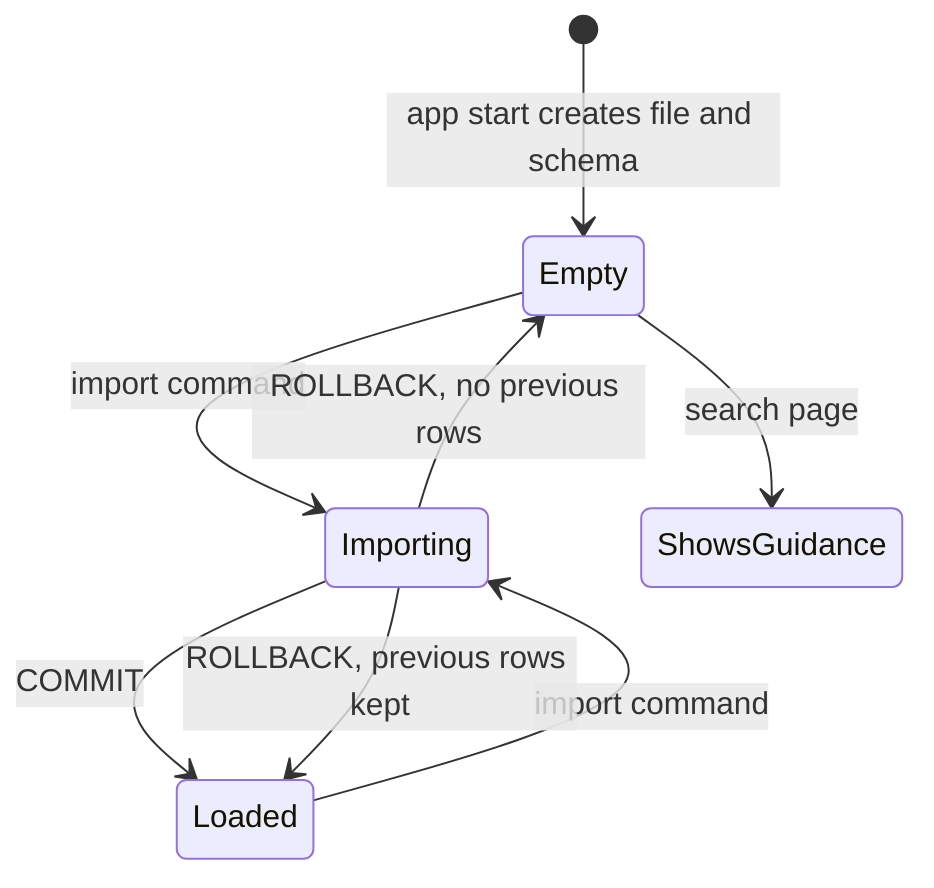
```

## docs/TASKS.md (replace the named task lines; everything else unchanged)

```markdown
### T-03 (add to Behavior)
  init_schema() sets journal_mode=WAL and busy_timeout=10000 (NFR-R2).
  Test adds: test_nfr_r2_wal_mode_set.

### T-05 (add to Behavior and Test)
  Skip rows with non-integer Text# or a Text# seen earlier in the same file; count them.
  Importer connection sets busy_timeout=10000.
  Test adds: test_ac_01_7_duplicate_text_id, test_ac_01_8_non_integer_text_id.

### T-09 (replace ORDER BY)
  SELECT ... ORDER BY title COLLATE NOCASE, text_id LIMIT ? OFFSET ?.
  Test adds: test_ac_05_5_tie_break.

### T-10 (add to Behavior)
  On startup, create the parent folder, the DB file, and the schema if missing (AC-11.1).

### T-12 (add to Behavior and Test)
  Rows with in_catalog False show Text# and "no longer in catalog", no link (AC-09.3).
  POST routes check the Origin header per NFR-S7.
  Test adds: test_ac_09_3_missing_item_row, test_nfr_s7_foreign_origin_403.

### T-13 (replace escaping line and add tests)
  escape() applies to Title and Authors: `\` to `\\`, `]` to `\]`, newline to a space.
  Missing items export as `- Text# N (no longer in catalog)`.
  Test adds: test_ac_10_5_missing_item_line, test_ac_10_6_newline_and_author_bracket.

### T-14 (add to Test)
  test_nfr_s7_foreign_origin_403 moves here if not already in T-12. Keep it in one place only.
```

## docs/TESTING.md (add one fixture line)

```markdown
    sample.csv         also includes 1 duplicate Text# row and 1 row with Text# "abc"
                       (total 14 rows; T-04 test count becomes 14)
```

## PROGRESS.md (append rows)

```markdown
| 2026-10-21 | 5 | TASKS.md v0.1 approved by owner | CONTEXT_BUDGET.md | none |
| 2026-10-21 | 6 | CONTEXT_BUDGET.md with paste template | Skeptic pass | Cache facts UNVERIFIED |
| 2026-10-21 | 7 | 7 objections, 7 fixed, PRD v0.2 | Code at T-01 when owner says so | Mermaid render and book URL UNVERIFIED |
```

Gate check:
- Every gap is fixed or has a one-line reason. 7 fixed, 0 open.
- Re-check of earlier gates after the patches: every new AC is Given / When / Then; every new AC has a named test in TASKS.md; FR-11 now matches diagram 10; rules files are unchanged and still under 150 lines; no secrets added; new facts are internal design choices, not external claims.

Gate: PASS

Reply "continue" for the final message: doc tree and the FR to Diagram, Task, Test table.

---
## Turn 8 (2026-10-21T20:10:02-07:00)
### User
```
Accepted. Send the final message now: the doc tree and the FR ID, Diagram(s), Task(s), Test(s) table.
```
### Usage
{"input_tokens": 4, "cache_creation_input_tokens": 3495, "cache_read_input_tokens": 29758, "cache_creation": {"ephemeral_5m_input_tokens": 3495, "ephemeral_1h_input_tokens": 0}, "output_tokens": 4918, "service_tier": "standard", "inference_geo": "global", "speed": "standard", "output_tokens_details": {"thinking_tokens": 2058}}
Stop: end_turn. Cost: $0.31939
### Assistant

# Final message: doc tree and traceability table

No code in this message. Approval for docs/TASKS.md is recorded. Per your instruction, no code was written in this chat. Coding starts at T-01 in a new session when you say so, using the template in docs/CONTEXT_BUDGET.md.

## Doc tree (every .md file)

```
AGENTS.md
CLAUDE.md
PROGRESS.md
docs/
  README.md
  brief.md
  ASSUMPTIONS.md
  PRD.md                      (v0.2 after the skeptic pass)
  ARCHITECTURE.md
  SETUP.md
  CONTRIBUTING.md
  TESTING.md
  TASKS.md                    (approved, with Phase 7 patches)
  CONTEXT_BUDGET.md
  OBJECTIONS.md
  diagrams/
    01_user_story_map.md
    02_use_cases.md
    03_architecture.md
    04_sequence_search.md
    05_sequence_reading_list.md
    06_sequence_export.md
    07_sequence_import.md
    08_data_flow.md
    09_erd.md
    10_state.md               (catalog diagram replaced in Phase 7)
    11_class.md
    12_gui_mockup.md
```

Other config files produced (not .md): .env.example, .gitignore, .cursor/rules/project.mdc, .cursor/rules/templates.mdc.

Total: 26 .md files, 4 config files.

## FR ID, Diagram(s), Task(s), Test(s)

Diagram numbers refer to docs/diagrams/. Test names come from docs/TASKS.md and docs/TESTING.md.

| FR ID | Diagram(s) | Task(s) | Test(s) |
|-------|-----------|---------|---------|
| FR-01 | 01, 02, 03, 07, 08, 09, 10, 11 | T-03, T-05, T-06 | test_ac_01_1_imports_rows, test_ac_01_2_replaces_rows, test_ac_01_3_keeps_list, test_ac_01_4_skips_and_counts, test_ac_01_5_bad_encoding_exit_1, test_ac_01_6_missing_column_named, test_ac_01_7_duplicate_text_id, test_ac_01_8_non_integer_text_id, test_init_schema_creates_tables, test_init_schema_twice_is_safe, test_indexes_exist |
| FR-02 | 01, 02, 03, 04, 08, 11, 12 | T-07, T-10 | test_ac_02_1 to test_ac_02_6, test_ac_02_4_no_results_text, test_ac_02_5_prompt_text |
| FR-03 | 01, 02, 03, 04, 08, 11, 12 | T-08, T-10 | test_ac_03_1 to test_ac_03_4 |
| FR-04 | 01, 02, 03, 04, 11, 12 | T-08, T-10 | test_ac_04_1_distinct_sorted, test_ac_04_2_empty_catalog |
| FR-05 | 01, 02, 03, 04, 08, 11, 12 | T-09, T-10 | test_ac_05_1_first_page, test_ac_05_2_last_page, test_ac_05_3_beyond_last, test_ac_05_4_bad_page_number, test_ac_05_5_tie_break, test_ac_05_1_count_text |
| FR-06 | 01, 02, 03, 04, 08, 11, 12 | T-02, T-10 | test_ac_06_1_default_href, test_ac_06_2_custom_template, test_ac_06_3_noopener, test_settings_defaults, test_settings_env_override |
| FR-07 | 01, 02, 03, 05, 08, 09, 10, 11, 12 | T-11, T-12 | test_ac_07_1 to test_ac_07_4, test_add_route_redirects, test_add_full_notice, test_add_missing_404 |
| FR-08 | 01, 02, 03, 05, 10, 11, 12 | T-11, T-12 | test_ac_08_1, test_ac_08_2, test_remove_route |
| FR-09 | 01, 02, 03, 05, 06, 08, 09, 11, 12 | T-12 | test_ac_09_1_order, test_ac_09_2_empty_text, test_ac_09_3_missing_item_row, test_item_missing_after_refresh |
| FR-10 | 01, 02, 03, 06, 08, 11, 12 | T-13 | test_ac_10_1_two_bullets, test_ac_10_2_exact_line, test_ac_10_3_empty, test_ac_10_4_escape_bracket, test_ac_10_5_missing_item_line, test_ac_10_6_newline_and_author_bracket |
| FR-11 | 01, 02, 03, 04, 10, 11, 12 | T-03, T-07, T-10 | test_ac_11_1_no_db_file, test_ac_11_2_empty_catalog_raises, test_ac_11_2_empty_catalog_page |
| NFR-S1 | 03 | T-10 | Not listed |
| NFR-S2 | 03, 08 | T-14 | test_nfr_s2_no_outbound_connect |
| NFR-S3 | 03 | T-03, T-07, T-14 | test_nfr_s3_no_string_built_sql |
| NFR-S4 | 03 | T-02 | test_settings_defaults, test_settings_env_override, test_settings_bad_int_raises |
| NFR-S5 | 12 | T-10 | Not listed |
| NFR-S6 | Not listed | T-01 | Not listed |
| NFR-S7 | Not listed | T-12, T-14 | test_nfr_s7_foreign_origin_403 |
| NFR-P1 | Not listed | T-15 | test_nfr_p1_search_time |
| NFR-P2 | 07 | T-15 | test_nfr_p2_import_time |
| NFR-P3 | 07 | T-05 | Not listed |
| NFR-A1 to A3 | 12 | T-10, T-12 | test_search_page_renders_labels |
| NFR-A4 | Not listed | Not listed | Not listed |
| NFR-R1 | 07, 10 | T-05, T-06 | test_nfr_r1_failure_keeps_old_rows |
| NFR-R2 | Not listed | T-03, T-05 | test_nfr_r2_wal_mode_set |

Notes on "Not listed" rows:
- NFR-S1, S5, S6, P3: enforced by code review and the never-do list in AGENTS.md, not by a test. Add tests if you want them; T-14 is the natural place.
- NFR-A4 (WCAG 2.1 AA) is UNVERIFIED and has no automated check. Manual review only.
- The test name test_ac_11_1_no_db_file predates the Phase 7 change to FR-11. The agent doing T-10 should rename it to test_ac_11_1_creates_db_and_shows_notice.

## Eval checklist status

- [x] No code before written approval. No code at all in this chat.
- [x] PRD has FR IDs, Given / When / Then criteria, and a traceability section.
- [x] All required Mermaid diagrams present, including ERD, each citing FR IDs. Rendering UNVERIFIED by me.
- [x] Big-O table defines every symbol.
- [x] One short context file per agent, all under 150 lines, linking to docs.
- [x] .env in .gitignore, .env.example has names only, no secret in any file.
- [x] External facts linked or labeled UNVERIFIED: book URL, Cursor frontmatter, Claude @path, cache limits, WCAG, dependency versions.
- [x] Style rules met: no em dashes or en dashes, no tool credit lines.

## Open items for you before coding starts

1. Paste one diagram into a Mermaid renderer and report any error.
2. Open one gutenberg.org book page by hand and confirm or correct BOOK_URL_TEMPLATE.
3. Check the three provider caching links in docs/CONTEXT_BUDGET.md and fill the bracketed values.

When ready, start a new session with the docs/CONTEXT_BUDGET.md template and the request "Do task T-01 only."
